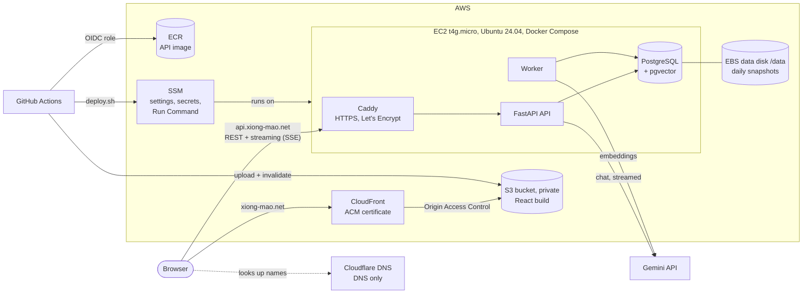

# Gehihi (xiong-mao.net)

Private AI chat over your own documents. Answers stream from Gemini and cite the uploaded files they come from. Chats live in projects, each with its own documents and search index.

- Frontend: React + TypeScript (Vite), served from a private S3 bucket through CloudFront at **https://xiong-mao.net**
- Backend: FastAPI + worker + PostgreSQL (pgvector) in Docker Compose on one EC2 server, behind Caddy at **https://api.xiong-mao.net**
- Sign-in: email and password in the API, with JWT access tokens. DNS: Cloudflare (free). Infrastructure: Terraform. CI/CD: GitHub Actions.

## Architecture



| Part | What it does |
| --- | --- |
| CloudFront + S3 | Serves the built web app over HTTPS. The bucket is private; only this CloudFront distribution can read it. |
| Caddy | Terminates HTTPS for the API with a free, auto-renewed Let's Encrypt certificate and streams answers through without buffering. |
| API (FastAPI) | Accounts and sign-in (JWT), chats, projects, uploads, usage. Streams Gemini answers to the browser as Server-Sent Events. |
| Worker | One process that extracts text from uploads, embeds it with Gemini and purges deleted data. |
| PostgreSQL + pgvector | All app data and the document vectors. Runs in its own container; its files live on the data disk. |
| Data disk (`/data`) | Separate EBS volume holding the database, uploads and Caddy certificates. The server can be replaced without losing it. Snapshotted daily. |
| SSM | Parameter Store holds the settings and secrets the server reads at deploy time. Run Command lets CI deploy without SSH. |

More detail: [docs/architecture.md](docs/architecture.md). Day-to-day tasks: [docs/operations.md](docs/operations.md).

### Monthly cost (us-east-1, on-demand)

| Item | Approx. USD/month |
| --- | --- |
| EC2 t4g.micro (1 GiB + 2 GiB swap) | 6.13 |
| Public IPv4 address (Elastic IP) | 3.65 |
| EBS gp3, 10 GiB system + 10 GiB data | 1.60 |
| Data disk snapshots (7 daily, incremental) | ~0.30 |
| S3, ECR (5 images), CloudFront, SSM, DLM | ~0.20 (mostly free tier) |
| **Total** | **~$12** |

A 1-year no-upfront Compute Savings Plan for the instance brings this to about $10. Gemini usage is billed separately by Google. There is no RDS, ECS, Fargate, ALB or NAT gateway. Burst CPU credits are set to `standard`, so the instance can never run up surprise CPU charges.

## Repository layout

```
backend/            FastAPI app, worker, Alembic migrations, tests (see backend/README.md)
frontend/           React + TypeScript (Vite) web app, unit and Playwright tests
deploy/             What runs on the server: compose.yaml, Caddyfile, deploy.sh
infra/              Terraform: network, EC2, S3, CloudFront, ACM, ECR, IAM, SSM
scripts/            start-local.ps1 / stop-local.ps1 / local_db.py for Windows development
.github/workflows/  ci.yml (tests) and deploy.yml (tests, then backend, then frontend)
Dockerfile          The API/worker image
```

## Run locally on Windows

Local mode needs no AWS account and no Docker. Create an account on the sign-in page; it lives in the local database. The database is a project-local PostgreSQL with pgvector (the `pgserver` Python package) in `.local-postgres\`; uploads go to `.local-storage\`. Your system PostgreSQL is not touched.

**1. Install the tools** (once, in PowerShell):

```powershell
winget install Python.Python.3.12
winget install OpenJS.NodeJS.LTS
Set-ExecutionPolicy -Scope CurrentUser RemoteSigned   # allow the local .ps1 scripts
```

**2. Install dependencies** (from the repository folder):

```powershell
py -3.12 -m venv backend\.venv
backend\.venv\Scripts\python -m pip install -r backend\requirements.lock
backend\.venv\Scripts\python -m pip install -e "backend[test,local]"
cd frontend; npm ci; cd ..
Copy-Item .env.example .env      # then put your GEMINI_API_KEY in .env
```

**3. Start and stop**

```powershell
.\scripts\start-local.ps1 -PaidCalls   # -PaidCalls lets it call the AI provider with your key (costs money)
.\scripts\stop-local.ps1
```

`start-local.ps1` starts the local database, applies migrations, then opens three windows: API on http://127.0.0.1:8000 (interactive docs at `/api/docs`, local only), the worker, and the web app on **http://localhost:5173** (`http://127.0.0.1:5173` works too). Without `-PaidCalls` the app runs, but no model is offered. To start over with an empty database, stop everything and delete `.local-postgres\`.

**Browse the database** with pgAdmin, DBeaver or any PostgreSQL tool: host `127.0.0.1`, port `55432`, user `postgres`, no password, database `chatbot`. It accepts connections only from this machine. It runs while the app runs; on its own, start it with `backend\.venv\Scripts\python scripts\local_db.py start`.

**4. Tests**

```powershell
$url = backend\.venv\Scripts\python scripts\local_db.py start
cd backend
$env:DATABASE_URL = $url -replace '/chatbot$', '/chatbot_test'   # tests use their own database
.venv\Scripts\python -m pytest            # database tests are skipped if DATABASE_URL is unset
.venv\Scripts\ruff check app worker migrations tests
cd ..\frontend
npm test; npm run build
npx playwright install chromium; npm run test:e2e   # uses a mocked API
```

## Deploy to AWS (from Windows)

Nothing is created in AWS until you run `terraform apply` yourself. Steps 1 to 6 are done once; after that, every push to `main` deploys automatically.

**Prerequisites**

```powershell
winget install Hashicorp.Terraform
winget install Amazon.AWSCLI
winget install Amazon.SessionManagerPlugin   # shell access to the server without SSH
winget install GitHub.cli
aws configure          # an IAM user/role that may create the resources (e.g. AdministratorAccess)
$env:AWS_REGION = "us-east-1"
```

You also need `xiong-mao.net` added to Cloudflare (free plan) and a Gemini API key.

**1. Configure Terraform**

```powershell
cd infra
Copy-Item terraform.tfvars.example terraform.tfvars   # edit if you change region, repo, branch...
terraform init
```

Read Gemini's data terms, then set `provider_retention_verified = true` in `terraform.tfvars`. Until you do, the app offers no models.

**2. Request the frontend certificate**

```powershell
terraform apply -target="aws_acm_certificate.frontend"
terraform output acm_validation_record
```

In Cloudflare, under **DNS > Records**, add that **CNAME** with proxy status **DNS only**. Drop the trailing dots.

**3. Create everything else**

```powershell
terraform plan -out tfplan    # review what will be created
terraform apply tfplan        # waits until the certificate is issued (usually a few minutes)
```

**4. Point the domains at AWS** (Cloudflare, both **DNS only** / grey cloud):

```powershell
terraform output cloudflare_dns_records
```

| Type | Name | Content |
| --- | --- | --- |
| CNAME | `xiong-mao.net` (`@`) | `dxxxxxxxx.cloudfront.net` |
| A | `api` | the Elastic IP |

"DNS only" matters. Caddy needs direct traffic to obtain its certificate, and Cloudflare's proxy would cut long streamed answers after 100 seconds.

**5. Store the secrets in SSM Parameter Store** (never in Git or Terraform):

```powershell
$path = terraform output -raw parameter_path
aws ssm put-parameter --name "$path/GEMINI_API_KEY" --type SecureString --value "YOUR_GEMINI_KEY"
$fernet = ..\backend\.venv\Scripts\python -c "from cryptography.fernet import Fernet; print(Fernet.generate_key().decode())"
aws ssm put-parameter --name "$path/KEY_ENCRYPTION_KEY" --type SecureString --value $fernet
$jwt = ..\backend\.venv\Scripts\python -c "import secrets; print(secrets.token_urlsafe(48))"
aws ssm put-parameter --name "$path/JWT_SECRET" --type SecureString --value $jwt
```

To change a secret later, run the same command with `--overwrite`, then redeploy.

**6. Give GitHub Actions its settings** (repository variables, none of them secret):

```powershell
gh auth login
$vars = terraform output -json github_variables | ConvertFrom-Json
$vars.PSObject.Properties | ForEach-Object { gh variable set $_.Name --body $_.Value }
```

**7. Deploy**

The workflow deploys pushes to `main`, the only branch AWS trusts (`github_branch`). Development happens on `dev`, so publish it to `main`:

```powershell
git push origin dev:main
gh run watch
```

The **Deploy** workflow runs four steps in order:

1. Run all tests.
2. Build the arm64 API image and push it to ECR.
3. Tell the server through SSM to run `deploy/deploy.sh`. The script builds `.env` from Parameter Store, stops the worker, pulls the images, runs migrations, starts the stack and checks `/health/ready`.
4. Build the frontend, upload it to S3 and invalidate CloudFront.

**8. Check it**

```powershell
curl.exe https://api.xiong-mao.net/api/v1/health/ready
start https://xiong-mao.net
```

Create an account on the sign-in page and start chatting. On the very first deploy Caddy may need a minute after DNS resolves to get its certificate.

## Configuration

Server settings are SSM parameters under `/xiongmao/prod/`. Terraform creates the non-secret ones from `variables.tf`; you add the secrets in step 5. `deploy.sh` turns every parameter into a line of the server's `.env`, so a change takes effect on the next deploy. Locally the same names go in `.env`.

| Setting | Purpose |
| --- | --- |
| `GEMINI_API_KEY` | Shared Gemini key (secret). Users can also save their own key in Settings, API keys. |
| `KEY_ENCRYPTION_KEY` | Fernet key that encrypts users' own API keys (secret). Without it, saving keys returns 503. |
| `JWT_SECRET` | Signs access tokens (secret, 32+ characters; the API refuses to start in production without it). Changing it signs everyone out of their current access token; browsers renew it with their refresh cookie. Locally a temporary one is used if it is empty. |
| `ACCESS_TOKEN_MINUTES`, `REFRESH_TOKEN_DAYS` | Default `15` and `30`: access-token lifetime, and how long a browser stays signed in without visiting. |
| `MODEL_DISCOVERY` | Default `true`: the picker lists every chat model each provider offers for the key in use (the user's own key or the shared one), refreshed hourly. |
| `MODEL_CATALOG_JSON` | Fixed models, listed first: `{id, provider, label, api_model, context_tokens}`. An entry overrides the discovered model with the same `api_model`. The `id` is stored with history; never reuse one for a different model. |
| `EMBEDDING_PROVIDER`, `EMBEDDING_MODEL`, `EMBEDDING_DIMENSIONS` | `gemini`, `gemini-embedding-001`, `1536`. One model for all documents; changing it means re-uploading them. |
| `PROVIDER_RETENTION_VERIFIED`, `PROVIDER_POLICY_URL` | Gate that enables models once you have reviewed the provider's terms, and the link shown in Settings. |
| `CORS_ORIGINS`, `APP_ENV` | Set by Terraform. |
| `OPENAI_API_KEY` | Optional. Add it (and OpenAI entries in the catalog) to offer OpenAI models too. |
| `backend/app/services/rates.json` | Prices per million tokens, keyed by catalog `id`. Each call stores a snapshot, so price changes never rewrite history; a model without a rate shows cost as unknown. |

Database migrations are in `backend/migrations/versions/` (0001 base schema, 0002 projects, 0003 free chats, 0004 personal API keys, 0005 email and password sign-in). They run automatically on every deploy and when starting locally.

## Features

| Area | What it does |
| --- | --- |
| Chat | Streamed answers, stop, copy, regenerate, branch from any answer, safe Markdown, title search, rename, delete. Tokens and estimated cost under each answer. |
| Models | Server-side catalog. Settings, Models narrows the picker to a shortlist. |
| Projects | Each project has its own documents, chats and search index. Nothing crosses projects. |
| Free chats | Chats outside any project; they use only documents uploaded into that chat. |
| Documents | Text PDF, TXT and Markdown up to 10 MiB and 100 pages. Status, retry, rename, download, delete. Citations show file, page and snippet. |
| Usage | Requests, tokens and estimated cost by day and by model; unknown values stay unknown. |
| Settings | Light/dark/system mode, color themes, fonts, response styles, model shortlist, personal API keys. |
| Accounts | Email and password sign-up and sign-in, password change (signs out other browsers), profile, account deletion confirmed by password. Five wrong passwords lock that email for 15 minutes. No email verification or emailed password reset yet. |

## Limits

- One server and one worker. If the server is down, the app is down; restoring is covered in [operations](docs/operations.md).
- Per user: 10 requests a minute, 100 a day, 2 running answers, 100 files, 100 MiB. These are safeguards, not a spending cap.
- Gemini does not report embedding token counts, so document indexing cost shows as unknown.
- No OCR or scanned PDFs, no automatic provider retry, no worker takeover after a crash.
- Deleted content is hidden at once and purged by the worker. Copies already sent to Gemini follow Google's retention terms.
