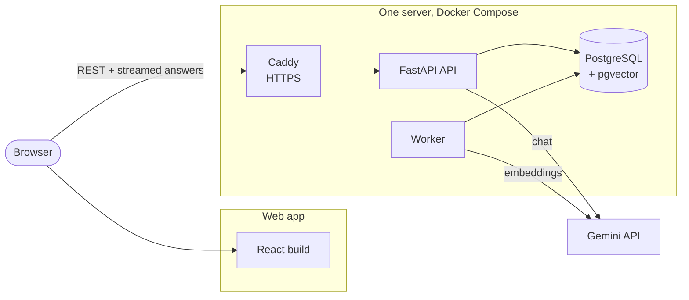
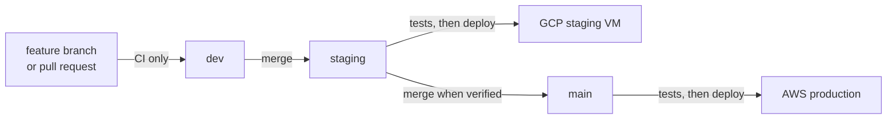

# Gehihi (xiong-mao.net)

Private AI chat over your own documents. Upload PDFs, text or Markdown files into a project, ask questions, and get streamed answers from Gemini that cite the file, page and passage they come from.

| | |
| --- | --- |
| **Frontend** | React + TypeScript (Vite) |
| **Backend** | FastAPI API + one background worker, Python 3.12 |
| **Database** | PostgreSQL 16 with pgvector (chats, accounts and document vectors in one place) |
| **AI** | Gemini for chat and embeddings; OpenAI optional |
| **Hosting** | AWS (production) and one GCP VM (staging), both deployed by GitHub Actions |

## How it fits together



Every environment runs the same API image and the same `deploy/compose.yaml`. Only where the web app is served and where the settings come from change:

| | Local (Windows) | Staging (GCP) | Production (AWS) |
| --- | --- | --- | --- |
| Deploys from | `.\scripts\start-local.ps1` | push to `staging` | push to `main` |
| Web app | Vite dev server, `localhost:5173` | Caddy on the VM, same domain as the API | S3 + CloudFront, `xiong-mao.net` |
| API | `127.0.0.1:8000` | `https://<domain>/api` | `https://api.xiong-mao.net` |
| Database | project-local PostgreSQL in `.local-postgres\` | container, data in `/data` on the VM | container, data on a separate EBS disk |
| Settings | `.env` | GitHub environment `staging` | SSM Parameter Store |
| Guide | [Run locally](#run-locally-on-windows) | [docs/staging-gcp.md](docs/staging-gcp.md) | [docs/deploy-aws.md](docs/deploy-aws.md) |

## Documentation

| Read this | When you want to |
| --- | --- |
| [docs/architecture.md](docs/architecture.md) | Understand production: request paths, the server, security, costs and why it is built this way |
| [docs/deploy-aws.md](docs/deploy-aws.md) | Set up production on AWS from scratch, or understand how a deploy works |
| [docs/staging-gcp.md](docs/staging-gcp.md) | Set up or run the staging VM on GCP |
| [docs/operations.md](docs/operations.md) | Run production: shell access, rollback, backups, restore, resize, tear down |
| [docs/configuration.md](docs/configuration.md) | Look up a setting and where each environment gets it |
| [backend/README.md](backend/README.md) | Find your way around the backend code and add a feature |
| [frontend/README.md](frontend/README.md) | Find your way around the web app code |

## Run locally on Windows

Local mode needs no cloud account and no Docker. The database is a project-local PostgreSQL with pgvector (the `pgserver` Python package) in `.local-postgres\`, and uploads go to `.local-storage\`. Any PostgreSQL already installed on the machine is not touched.

**1. Install the tools** (once, in PowerShell):

```powershell
winget install Python.Python.3.12
winget install OpenJS.NodeJS.LTS
Set-ExecutionPolicy -Scope CurrentUser RemoteSigned   # allow the local .ps1 scripts
```

**2. Install dependencies** (from the repository folder):

```powershell
py -3.12 -m venv backend\.venv
backend\.venv\Scripts\python -m pip install -r backend\requirements.lock
backend\.venv\Scripts\python -m pip install -e "backend[test,local]"
cd frontend; npm ci; cd ..
Copy-Item .env.example .env      # then put your GEMINI_API_KEY in .env
```

**3. Start and stop**

```powershell
.\scripts\start-local.ps1 -PaidCalls   # -PaidCalls lets the app call the AI provider with your key (costs money)
.\scripts\stop-local.ps1
```

`start-local.ps1` starts the database, applies migrations, then opens three windows:

| Window | Address |
| --- | --- |
| API | http://127.0.0.1:8000 (interactive docs at `/api/docs`, local only) |
| Worker | none (indexes uploads in the background) |
| Web app | **http://localhost:5173** |

Create an account on the sign-in page. Without `-PaidCalls` the app runs, but no model is offered. To start over with an empty database, stop everything and delete `.local-postgres\`.

**Browse the database** with pgAdmin, DBeaver or any PostgreSQL tool: host `127.0.0.1`, port `55432`, user `postgres`, no password, database `chatbot`. It accepts connections only from this machine. To start it on its own, run `backend\.venv\Scripts\python scripts\local_db.py start`.

**4. Tests** (the same checks CI runs)

```powershell
$url = backend\.venv\Scripts\python scripts\local_db.py start
cd backend
$env:DATABASE_URL = $url -replace '/chatbot$', '/chatbot_test'   # tests use their own database
.venv\Scripts\python -m pytest            # database tests are skipped if DATABASE_URL is unset
.venv\Scripts\ruff check app worker migrations tests
cd ..\frontend
npm test; npm run build
npx playwright install chromium; npm run test:e2e   # uses a mocked API
```

## Branches and CI/CD



| Workflow | Runs on | Does |
| --- | --- | --- |
| `ci.yml` | pull requests and pushes to any other branch | ruff, migrations + `alembic check`, pytest on PostgreSQL, unit tests, production build, Playwright, Terraform validation |
| `staging.yml` | push to `staging` | `ci.yml`, then deploys to the GCP VM over SSH |
| `deploy.yml` | push to `main` | `ci.yml`, then deploys the backend to EC2 and the web app to S3/CloudFront |

A deploy only starts if every test passes.

## Repository layout

```
backend/            FastAPI app, worker, Alembic migrations, tests        -> backend/README.md
frontend/           React + TypeScript web app, unit and Playwright tests -> frontend/README.md
deploy/             What runs on a server: compose.yaml, Caddyfile, deploy.sh
deploy/staging/     GCP staging additions: Caddy also serves the web app, setup-vm.sh, deploy.sh
infra/              Terraform for AWS: network, EC2, S3, CloudFront, ACM, ECR, IAM, SSM
scripts/            start-local.ps1, stop-local.ps1, local_db.py for Windows development
.github/workflows/  ci.yml, staging.yml, deploy.yml
Dockerfile          The API and worker image (one image, two commands)
```

## Features

| Area | What it does |
| --- | --- |
| Chat | Streamed answers, stop, copy, regenerate, branch from any answer, safe Markdown, title search, rename, delete. Tokens and estimated cost under each answer. |
| Projects | Each project has its own documents, chats and search index. Nothing crosses projects. |
| Free chats | Chats outside any project; they use only documents uploaded into that chat. |
| Documents | Text PDF, TXT and Markdown up to 10 MiB and 100 pages, by button or drag and drop. Status, retry, rename, download, delete. Citations show file, page and snippet. |
| Models | The picker lists the chat models each provider offers for the key in use. Settings, Models narrows it to a shortlist. |
| Usage | Requests, tokens and estimated cost by day and by model, in your time zone. Unknown values stay unknown. |
| Settings | Light/dark/system mode, color themes, fonts, response styles, model shortlist, personal API keys. |
| Accounts | Email and password sign-up and sign-in, password change (signs out other browsers), profile, account deletion confirmed by password. |

## Limits

- **One server, one worker.** If the server is down, the app is down. Recovery is in [operations](docs/operations.md).
- **Per user:** 10 answers a minute, 100 a day, 2 at a time, 100 files, 100 MiB. These are safeguards, not a spending cap.
- **Sign-in:** 5 wrong passwords lock that email for 15 minutes (20 per IP address). No email verification or emailed password reset yet.
- **Documents:** no OCR, so scanned PDFs are rejected. Gemini does not report embedding token counts, so indexing cost shows as unknown.
- **Failures:** no automatic provider retry, and no worker takeover after a crash (paid calls are never replayed on their own).
- **Deletion:** deleted content is hidden at once and purged by the worker. Copies already sent to Gemini follow Google's retention terms.
