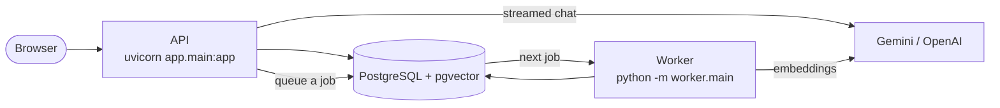
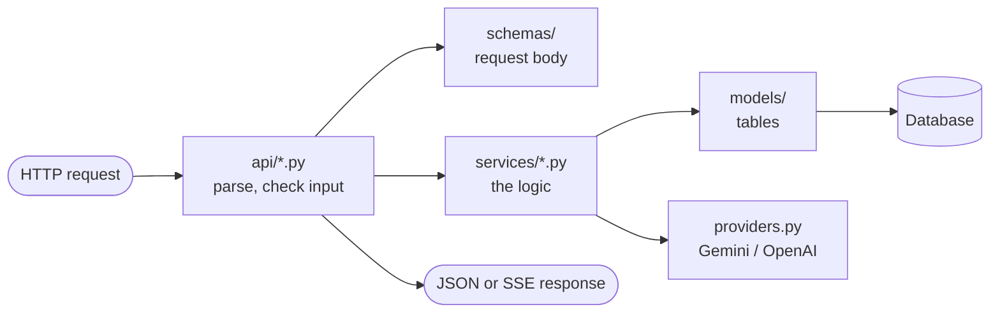

# Backend

A FastAPI API plus one background worker. They share the same code, the same Docker image and the same PostgreSQL database.



The API answers HTTP requests. Slow work (reading uploads, embedding them, purging deleted data) goes into a `jobs` table, and the worker picks it up from there.

## Layout

```
backend/
├── app/
│   ├── main.py              App setup: logging, CORS, security headers, error format, mounts /api/v1
│   ├── core/                Plumbing every layer uses (no business rules)
│   │   ├── config.py        Settings from environment / .env, model catalog
│   │   ├── database.py      Engine, Session, get_db, declarative Base
│   │   ├── security.py      Password hashing, JWT access tokens, current_user dependency
│   │   └── storage.py       Uploaded files and deletion journal (on disk, STORAGE_DIR)
│   ├── models/              Database tables (SQLAlchemy), one file per area
│   │   ├── user.py          User, UserKey, LoginSession (refresh-token sessions)
│   │   ├── project.py       Project
│   │   ├── chat.py          Conversation, Message, Generation
│   │   ├── document.py      Document, Chunk (vector)
│   │   ├── usage.py         Usage (cost ledger)
│   │   └── jobs.py          Job (worker queue), Deletion
│   ├── schemas/             Request bodies (Pydantic), one file per area
│   ├── api/                 HTTP routes, one file per resource. Thin: validate, call a service, return JSON
│   │   ├── auth.py          /auth (sign up, sign in, refresh, sign out, password)
│   │   ├── account.py       /me              preferences.py  /me/preferences    keys.py   /me/keys
│   │   ├── catalog.py       /models          projects.py     /projects          health.py /health
│   │   ├── conversations.py /conversations   generations.py  answers (SSE)      usage.py  /usage
│   │   └── documents.py     /documents       deletions.py    /deletions/{id}
│   └── services/            Business logic. No routes; callable from the API, the worker and tests
│       ├── projects.py, conversations.py, branching.py, documents.py, preferences.py, api_keys.py
│       ├── auth.py          Accounts and sign-in sessions (refresh tokens, sign-in limits)
│       ├── model_catalog.py Which models a user can pick: each provider's live list + MODEL_CATALOG_JSON
│       ├── generations.py   Admission: limits, idempotency, which documents an answer may use
│       ├── chat_stream.py   Runs one answer and streams it to the browser
│       ├── prompts.py       System prompt and chat history sent to the model
│       ├── providers.py     Gemini / OpenAI calls: streamed chat and embeddings
│       ├── ingestion.py     File -> text -> chunks (worker)
│       ├── retrieval.py     Question -> most relevant chunks (pgvector)
│       ├── usage.py         Usage ledger and cost estimates (rates.json holds prices)
│       ├── deletions.py     Deletion requests (journal first)
│       └── deletion_rules.py What deleting each resource type hides, stops and removes
├── worker/main.py           Background loop: ingest documents, purge deleted data
├── migrations/              Alembic migrations (run automatically on deploy and local start)
├── tests/                   pytest; database tests need DATABASE_URL
├── pyproject.toml           Package, dependency ranges, ruff and pytest settings
└── requirements.lock        Exact versions installed in the image and in CI
```

## How a request flows



The rules that keep the layers easy to follow:

- `api/` only talks HTTP: path and query parameters, status codes, the JSON shape (`*_json` helpers).
- `services/` holds the logic. It may raise `HTTPException` for "not found" and "not allowed" cases, but never defines routes.
- `models/` and `schemas/` only describe data.
- `core/` knows nothing about chats or documents.
- Code that runs outside a request opens its own session with `database.Session()`. Import the module (`from app.core import database`), not the name, so tests can swap the database in one place.

Errors always have the same JSON shape: `{"code": "...", "message": "...", "request_id": "..."}`. The app shows the request ID with the message, and a server error (500) logs it with the full traceback, so a user's report can be matched to its log line.

## Adding a feature

For example, "tags on conversations":

1. **Table:** add the column or table in `models/chat.py`, then write a migration in `migrations/versions/` (`0006_...py`). CI runs `alembic check`, which fails if a model change has no migration.
2. **Request body:** add it in `schemas/chat.py` and export it from `schemas/__init__.py`.
3. **Logic:** add it in `services/conversations.py`, or create `services/tags.py` if it is a new area.
4. **Route:** add it in `api/conversations.py`. For a new resource, create `api/tags.py` and add it to the list in `api/__init__.py`.
5. **Test:** add one in `tests/`.

**Adding a dependency:** add the range to `pyproject.toml` and the exact version to `requirements.lock`. The image installs only what the lock lists, so a package missing from it is missing in production even if it works on your machine.

## Run and test

Full setup is in the main [README](../README.md#run-locally). In short, from the repository root on Linux or macOS:

```bash
./scripts/start-local.sh --paid-calls      # database, API, worker, web app
cd backend
export DATABASE_URL=$(.venv/bin/python ../scripts/local_db.py start | sed 's#/chatbot?#/chatbot_test?#')
.venv/bin/python -m pytest
.venv/bin/ruff check app worker migrations tests
```

On Windows, see the PowerShell commands in the README.
