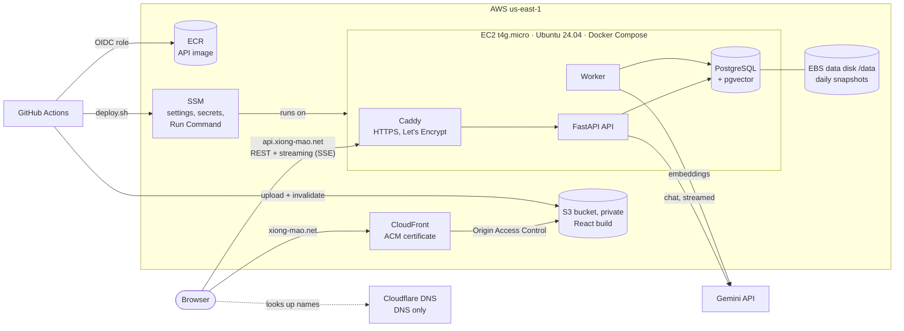
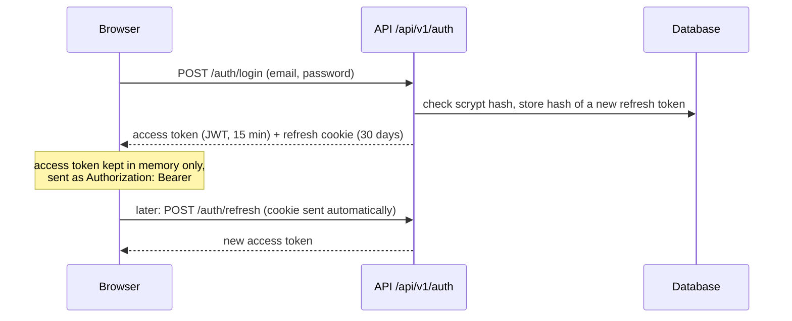
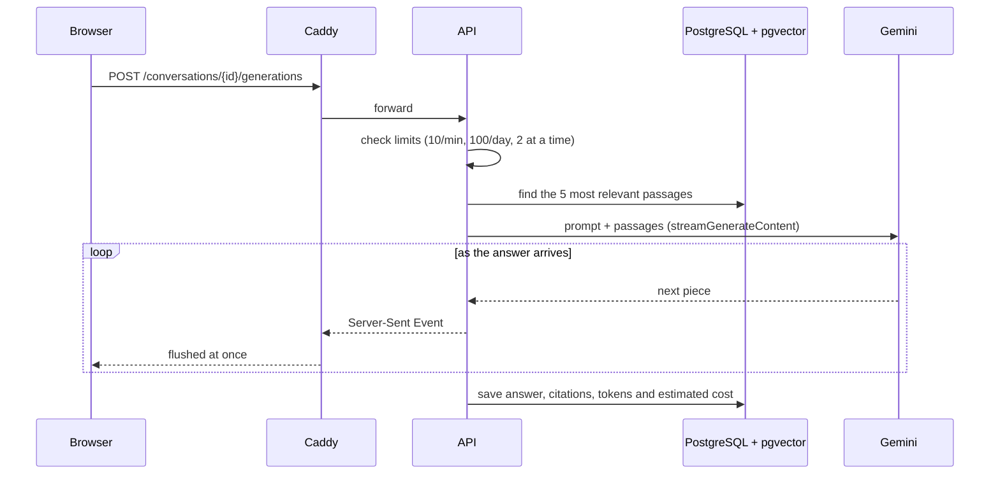
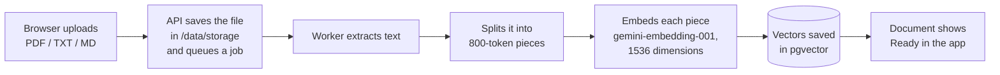

# Architecture (production on AWS)

Production is two pieces: a static web app on **S3 + CloudFront**, and **one EC2 server** that runs the backend and the database as Docker containers. Staging on GCP runs the same containers on one VM ([staging-gcp.md](staging-gcp.md)).

| Part | What it does |
| --- | --- |
| CloudFront + S3 | Serves the built web app over HTTPS. The bucket is private; only this CloudFront distribution can read it. Any path the bucket does not have returns `index.html`, so routes like `/projects` work. |
| Caddy | Terminates HTTPS for the API with a free, auto-renewed Let's Encrypt certificate, and passes streamed answers through without buffering. |
| API (FastAPI) | Accounts and sign-in, chats, projects, uploads, usage. Streams answers to the browser as Server-Sent Events. |
| Worker | One process that extracts text from uploads, embeds it and purges deleted data. |
| PostgreSQL + pgvector | All app data and the document vectors, in its own container. Its files live on the data disk. |
| Data disk (`/data`) | A separate encrypted EBS volume holding the database, uploads and Caddy certificates. The server can be replaced without losing it. Snapshotted daily. |
| ECR | Holds the API image (the last 5, tagged by commit). |
| SSM | Parameter Store holds the settings and secrets. Run Command lets CI deploy, and Session Manager gives shell access, without SSH. |

## What happens on a request

### Signing in

The refresh cookie is `httpOnly`, `Secure` and `SameSite=Strict`, and only `/api/v1/auth` receives it. The database stores only a hash of each refresh token, so signing out or changing the password ends those sessions at once.

### Asking a question

### Uploading a document

## On the server

`deploy/compose.yaml` runs five containers. Only Caddy publishes ports (80 and 443). PostgreSQL is reachable only on the Docker network.

| Service | Image | Notes |
| --- | --- | --- |
| `caddy` | `caddy:2` | Gets and renews the certificate (state in `/data/caddy`), adds HSTS, rejects request bodies over 12 MB. |
| `api` | ECR image | `uvicorn app.main:app`, runs as uid 10001. |
| `worker` | same image | `python -m worker.main`. Exactly one must run. |
| `migrate` | same image | `alembic upgrade head`, then exits. `api` and `worker` start only if it succeeds. |
| `db` | `pgvector/pgvector:pg16` | Data in `/data/postgres`. The password is generated on the server and kept in `/data/postgres-password`. |

The first-boot script (`infra/user_data.sh.tftpl`) installs Docker, adds 2 GiB swap and mounts the data disk. It formats the disk only when the disk is blank, so replacing the server keeps every chat and document. Terraform refuses to delete the disk (`prevent_destroy`).

## Security

| Concern | How it is handled |
| --- | --- |
| Cloud credentials | No AWS keys in GitHub. Actions assumes the role `xiongmao-github-deploy` through OpenID Connect, and only pushes to `main` of `hiimmuc/xiongmao-chat-rag` may. The role can push one ECR repository, write two buckets, invalidate one distribution, and run commands only on the instance tagged `xiongmao-api`. |
| Server access | No SSH and no port 22. Deploys use SSM Run Command, and admin shells use Session Manager. Both are authorized through IAM. |
| Secrets | Kept out of Git and Terraform state. You add `GEMINI_API_KEY`, `KEY_ENCRYPTION_KEY` and `JWT_SECRET` as SecureString parameters. At deploy time the server reads them into a root-only `.env`. |
| Server role | Only the host can use the instance's AWS role (metadata hop limit 1, tokens required). The containers never call AWS, so a compromised container cannot read Parameter Store. |
| Users' own API keys | Encrypted with Fernet (`KEY_ENCRYPTION_KEY`) before they are stored. |
| Production mode | `APP_ENV=production`: the API refuses to start without a strong `JWT_SECRET`, cookies are `Secure`, the interactive API docs are off, and CORS allows only `https://xiong-mao.net`. |
| Release order | Backend first, then frontend, so a new web app never calls an API that lacks its endpoints. The worker stops before migrations, so two workers never overlap. |

## Monthly cost (us-east-1, on-demand)

| Item | Approx. USD/month |
| --- | --- |
| EC2 t4g.micro (1 GiB + 2 GiB swap) | 6.13 |
| Public IPv4 address (Elastic IP) | 3.65 |
| EBS gp3, 10 GiB system + 10 GiB data | 1.60 |
| Data disk snapshots (7 daily, incremental) | ~0.30 |
| S3, ECR (5 images), CloudFront, SSM, DLM | ~0.20 (mostly free tier) |
| **Total** | **~$12** |

A 1-year no-upfront Compute Savings Plan for the instance brings this to about $10. Gemini usage is billed separately by Google. Burst CPU credits are set to `standard`, so the instance can never run up surprise CPU charges. The full breakdown, and how the setup changes with a bigger budget or more traffic, is in [cost.md](cost.md).

## Why this shape

| Choice | Reason |
| --- | --- |
| One EC2 server with Docker Compose, not ECS/Fargate/ALB | An ALB alone costs more than the whole budget. Compose runs all five containers from one short file. |
| PostgreSQL in a container, not RDS | RDS's smallest instance costs more than the server. pgvector runs in the same database, so there is no separate vector service. |
| Caddy, not an ALB or nginx + certbot | Automatic HTTPS from a short config, with correct streaming. |
| Cloudflare DNS only (no proxy) | Free DNS. The proxy stays off because it would cut streamed answers after 100 s and block Caddy's certificate challenge. |
| t4g.micro (arm64) | The cheapest instance that fits, helped by 2 GiB swap. Set `instance_type = "t4g.small"` if memory gets tight. |
| Local disk for uploads, not S3 | One fewer service, and the files sit next to the database on the snapshotted disk. |
| Gemini for chat and embeddings | One provider key covers everything. OpenAI remains supported as an option. |

## Known limits

- **Single server:** a reboot or failure means downtime until it is back, usually about a minute ([operations](operations.md)).
- **One worker:** a job that is mid-way when the worker crashes stays in `processing` until an operator steps in. Paid calls are never replayed automatically.
- **Snapshots include the deletion journal:** restoring an older snapshot also brings back data deleted after it was taken. Repeat those deletions after a restore.
