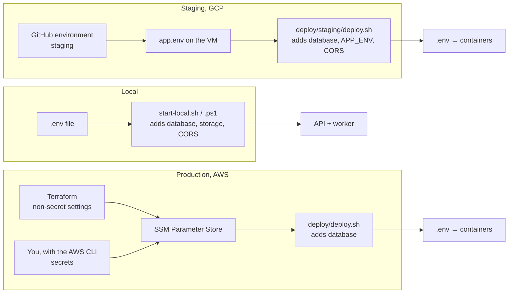

# Configuration

The API and the worker read their settings from environment variables (in code: `backend/app/core/config.py`). Each environment fills them in a different place, but the names are the same everywhere.

Settings are read when the containers start, so a change takes effect on the next deploy.

## Where to change a setting

| Environment | Non-secret settings | Secrets | Apply the change |
| --- | --- | --- | --- |
| Local | `.env` (copy from `.env.example`) | `.env` | restart `start-local.sh` (Linux/macOS) or `start-local.ps1` (Windows) |
| Staging | GitHub > Settings > Environments > `staging` > Variables | same page, Secrets | `gh workflow run staging.yml --ref staging` |
| Production | `infra/terraform.tfvars`, then `terraform apply` | `aws ssm put-parameter --overwrite` under `/xiongmao/prod/` | `gh workflow run deploy.yml` |

Never commit `.env` or `terraform.tfvars`. Both are git-ignored.

## Settings

| Setting | Default | Purpose |
| --- | --- | --- |
| `GEMINI_API_KEY` | none | **Secret.** Shared Gemini key for chat and embeddings. Users can also save their own key in Settings, API keys. |
| `JWT_SECRET` | random per run, local only | **Secret, required in production**, 32+ characters. Signs access tokens. Changing it ends current access tokens; browsers renew them with their refresh cookie. |
| `KEY_ENCRYPTION_KEY` | none | **Secret.** Fernet key that encrypts users' own API keys. Without it, saving a key returns 503. |
| `OPENAI_API_KEY` | none | **Secret, optional.** Also offer OpenAI models. |
| `PROVIDER_RETENTION_VERIFIED` | `false` | Set `true` once you have reviewed the provider's data terms. Until then no model is offered. Locally, `start-local.sh --paid-calls` (`start-local.ps1 -PaidCalls` on Windows) sets it. |
| `PROVIDER_POLICY_URL` | none | Link to those terms, shown in Settings. |
| `MODEL_DISCOVERY` | `true` | List every chat model each provider offers for the key in use, refreshed hourly. |
| `MODEL_CATALOG_JSON` | `[]` | Fixed models, listed first: `[{id, provider, label, api_model, context_tokens}]`. An entry overrides the discovered model with the same `api_model`. The `id` is stored with chat history, so never reuse one for a different model. |
| `EMBEDDING_PROVIDER`, `EMBEDDING_MODEL`, `EMBEDDING_DIMENSIONS` | `gemini`, `gemini-embedding-001`, `1536` | One model for all documents. Changing it means re-uploading them. |
| `ACCESS_TOKEN_MINUTES`, `REFRESH_TOKEN_DAYS` | `15`, `30` | Access-token lifetime, and how long a browser stays signed in without visiting. |
| `APP_ENV` | `local` | `production` on staging and production: secrets required, `Secure` cookies, API docs off. |
| `CORS_ORIGINS` | `http://localhost:5173` | Sites allowed to call the API. Set by Terraform (production) and `deploy.sh` (staging). |
| `DATABASE_URL`, `STORAGE_DIR` | local database, `.local-storage` | Set by the scripts in each environment. You never set them by hand. |

**Limits** (code defaults, not usually changed): `MAX_UPLOAD_BYTES` 10 MiB, `MAX_DOCUMENT_PAGES` 100, `MAX_USER_FILES` 100, `MAX_USER_BYTES` 100 MiB, `MAX_OUTPUT_TOKENS` 2048, `GENERATION_TIMEOUT` 120 seconds.

## Prices

`backend/app/services/rates.json` holds prices per million tokens, keyed by catalog `id`. Each call stores a price snapshot, so a price change never rewrites history. A model without a rate shows its cost as unknown.

## The web app

The web app has one build-time setting, `VITE_API_URL`, which tells it where the API is:

| Environment | Value |
| --- | --- |
| Local | unset: the app uses port 8000 on the page's own host |
| Staging | `/api/v1` (the same domain as the page) |
| Production | `https://api.xiong-mao.net/api/v1` (GitHub variable from `terraform output github_variables`) |

It is public, so never put a key in it.

## Database migrations

Migrations are in `backend/migrations/versions/`. They run automatically on every deploy (the `migrate` container) and when starting locally.

| Migration | Adds |
| --- | --- |
| `0001` | Base schema (users, chats, documents, vectors, usage, jobs) |
| `0002` | Projects, project-scoped documents, per-user preferences |
| `0003` | Free chats outside projects |
| `0004` | Personal API keys |
| `0005` | Email and password sign-in |
| `0006` | Model picker defaults (an empty saved list now means none) |
