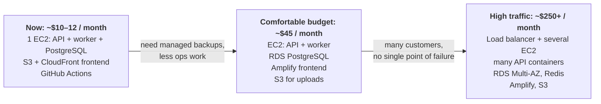
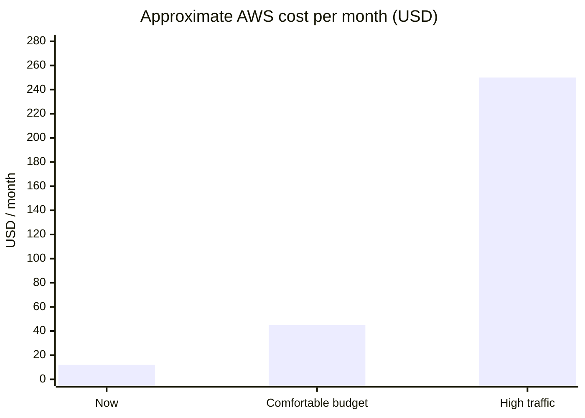
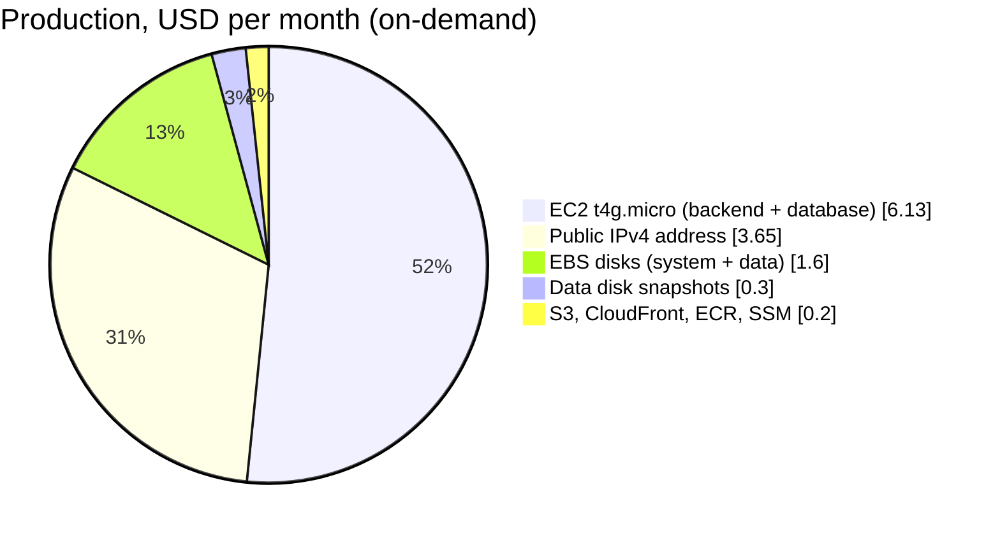
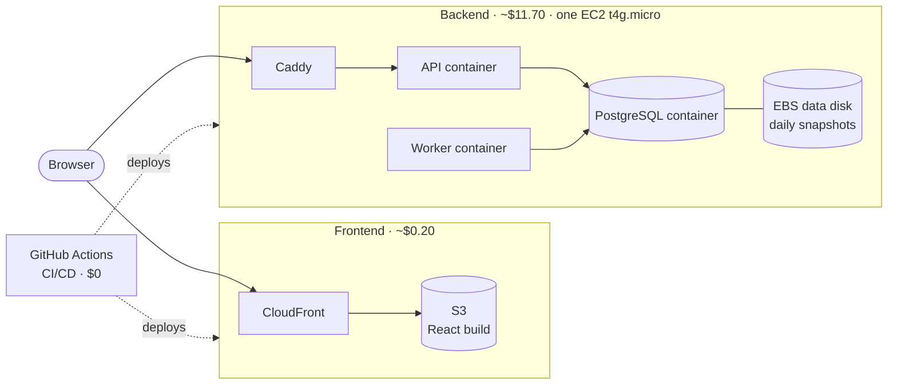
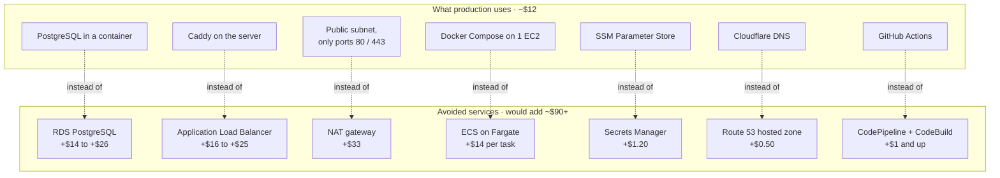
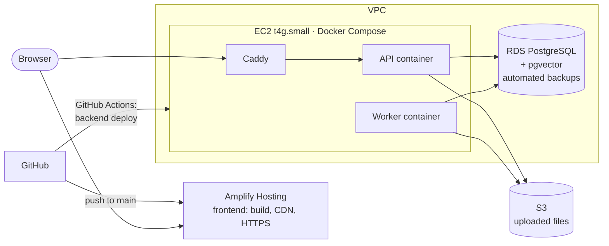
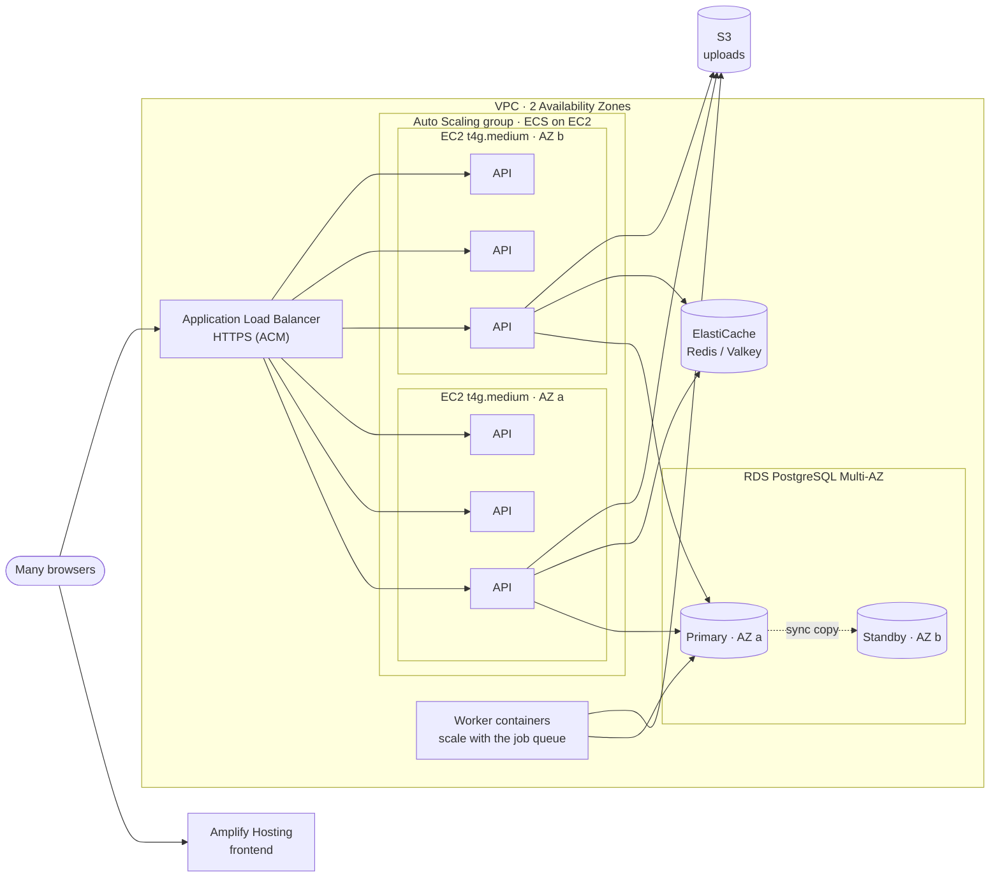

# Cost: how production runs for about $10 a month, and how it grows

Production costs **about $12 a month on-demand, or about $10 with a 1-year Savings Plan**. Almost all of it is the one EC2 server that runs the backend and the database. The frontend is almost free.

Prices are AWS us-east-1 list prices at the time of writing, for a month of 730 hours. Check the [AWS Pricing Calculator](https://calculator.aws/) before you decide anything. AI provider charges (Gemini) are billed by Google and are not included.

## The path at a glance

## Now: where the ~$12 goes

| Item | What it is | USD / month |
| --- | --- | --- |
| EC2 t4g.micro | 2 vCPU (burstable), 1 GiB memory + 2 GiB swap, Graviton (arm64). Runs Caddy, the API, the worker and PostgreSQL as Docker containers. | 6.13 |
| Public IPv4 address | The Elastic IP for `api.xiong-mao.net`. AWS bills every public IPv4 address. | 3.65 |
| EBS gp3 | 10 GiB system disk + 10 GiB data disk (database, uploads, certificates) | 1.60 |
| Snapshots | 7 daily snapshots of the data disk, incremental | ~0.30 |
| S3 + CloudFront | The web app is a few MB of static files. CloudFront's always-free tier covers 1 TB of transfer and 10 million requests a month. | ~0.05 |
| ECR | Last 5 API images | ~0.10 |
| SSM, Data Lifecycle Manager, ACM, IAM | Parameter Store (standard), Run Command, Session Manager, snapshot scheduling, the frontend certificate | 0 |
| **Total, on-demand** | | **~12** |
| **Total, 1-year Compute Savings Plan** (no upfront) | The plan lowers the EC2 price; everything else stays the same | **~10** |

## The choices that keep it low

| Choice | Instead of | Saves per month | Trade-off |
| --- | --- | --- | --- |
| **PostgreSQL as a container on the same EC2 server**, with pgvector in the same database | RDS PostgreSQL (db.t4g.micro ~$12 + storage, or db.t4g.small ~$23) plus a separate vector database | ~$14–26 | Backups are disk snapshots, not point-in-time restore. Upgrades are done by us. |
| **Caddy** for HTTPS, with free Let's Encrypt certificates | Application Load Balancer | ~$16–25 | No load balancing, which one server doesn't need. |
| **Public subnet** with a firewall that allows only 80/443 | Private subnet + NAT gateway | ~$33 | The server has a public address, but nothing else is exposed and there is no SSH. |
| **Docker Compose on one server** | ECS on Fargate (one task with 0.5 vCPU and 1 GB is ~$14) | ~$14 per container | One server is one point of failure. |
| **Graviton t4g.micro** with standard CPU credits | x86 t3.micro, or unlimited credits | ~$1.50, and no surprise CPU bills | 1 GiB of memory, helped by 2 GiB of swap |
| **S3 + CloudFront** for the web app | A web server, or Amplify Hosting | ~$1–5 | We wire it up ourselves in Terraform. |
| **SSM Parameter Store** (standard tier) | Secrets Manager ($0.40 per secret) | ~$1.20 | No automatic secret rotation |
| **SSM Session Manager + Run Command** | A bastion host, SSH keys, or a VPN | ~$4+ | None: it is also more secure. |
| **Cloudflare DNS** (free) | Route 53 | $0.50 + queries | DNS lives outside AWS. |
| **GitHub Actions** for CI/CD | CodePipeline + CodeBuild | ~$1 and up | None |
| **ECR keeps 5 images; 7 snapshots** | Keeping everything | Stops storage growing forever | Older releases can't be rolled back to. |

**GitHub Actions is free here:** public repositories get unlimited minutes. Private repositories on the Free plan get 2,000 minutes a month. One deploy uses roughly 15–20 runner minutes (tests, the arm64 image build, the frontend upload), so about 100 deploys a month fit.

## With a comfortable budget: managed database, easy frontend (~$45 / month)

When paying more is fine and the goal is less operations work, move the database to a managed service and the frontend to a managed host. The backend stays on one EC2 server.

| Item | USD / month |
| --- | --- |
| EC2 t4g.small (2 GiB): API + worker containers + Caddy | 12.26 |
| Public IPv4 address | 3.65 |
| EBS gp3 10 GiB (system only; no data disk needed) | 0.80 |
| RDS PostgreSQL db.t4g.small, Single-AZ, 20 GiB gp3, 7-day automated backups | ~25.70 |
| S3 for uploads (a few GB) | ~0.50 |
| Amplify Hosting (builds, storage, transfer for a small app) | ~1–5 |
| ECR, SSM | ~0.20 |
| **Total** | **~$45** |

What each change buys:

| Change | Benefit |
| --- | --- |
| **RDS PostgreSQL** (supports pgvector) | Automated backups with point-in-time restore to any second in the last 7 days, managed minor upgrades, and a one-click switch to Multi-AZ later. There is no data disk to look after. |
| **Amplify Hosting** for the frontend | Connects to the GitHub repository, then builds and hosts the app with CDN and HTTPS. Pull requests can get preview sites. It replaces the S3 bucket, CloudFront, ACM and their Terraform. |
| **S3 for uploads** | The EC2 server holds no data, so it can be replaced at any time. This is also the first step towards several servers. |
| **t4g.small** | Twice the memory. PostgreSQL has moved off the server, so the API and worker get it all. |

Changes needed in this repository:

1. `backend/app/core/storage.py`: store uploads and the deletion journal in S3 instead of on disk. The API and worker get an IAM role for that bucket.
2. `deploy/compose.yaml`: remove the `db` service. `DATABASE_URL` points to the RDS endpoint, and the password goes into Parameter Store.
3. `infra/`: add RDS (in private subnets that only the server's security group can reach), the uploads bucket and an Amplify app. Remove the data disk, `frontend.tf`, and the frontend job in `deploy.yml`.
4. Move the existing data once: `pg_dump` from the container, `pg_restore` into RDS, and copy `/data/storage` to S3.

## With many customers: scale out (~$250+ / month)

For lots of traffic, run several API containers on several servers behind a load balancer, so one failure does not take the app down. The cost below is for the AWS base; traffic and the AI provider come on top, and at this size the AI provider is usually the biggest bill.

| Item | USD / month |
| --- | --- |
| Application Load Balancer (base + light traffic) | ~25 |
| 2 × EC2 t4g.medium (4 GiB each) running several API containers, in an Auto Scaling group | ~49 |
| Worker capacity (1 × t4g.small to start) | ~12 |
| Public IPv4 for the instances (public subnets that only the load balancer can reach, so no NAT gateway) | ~11 |
| RDS PostgreSQL db.t4g.medium **Multi-AZ**, 100 GiB gp3 | ~118 |
| ElastiCache (cache.t4g.micro): shared rate limits and caches | ~10 |
| Amplify + S3 at higher traffic | ~10–30 |
| **Total base** | **~$250**, then add more instances as traffic grows |

How it scales:

| Part | How it grows |
| --- | --- |
| API | ECS runs many API containers on each EC2 server, and the Auto Scaling group adds servers on CPU or request count. The load balancer spreads traffic and drops unhealthy containers (`/api/v1/health/ready`). |
| Worker | More worker containers when the job queue grows. The queue already claims jobs with `FOR UPDATE SKIP LOCKED`, so two workers never take the same job. |
| Database | Multi-AZ fails over automatically. Add a read replica for heavy reads, then a bigger instance class. |
| Frontend | Amplify's CDN scales by itself. |

Changes needed in this repository, on top of the comfortable-budget ones:

1. **Shared sign-in limits:** failed sign-ins are counted in each API process's memory (`backend/app/services/auth.py`). With many containers, move the counter to Redis or the database.
2. **Worker crash recovery:** give jobs a lease, so a job left in `processing` by a crashed worker is retried automatically, without replaying a paid call. Today an operator steps in.
3. **Streaming through the load balancer:** raise the load balancer's idle timeout to about 300 seconds, so long streamed answers are never cut.
4. **Deploys:** an ECS rolling update replaces `deploy.sh`. Migrations run as a one-off task before the new containers start. GitHub Actions stays the CI/CD tool.

## Summary

| | Now | Comfortable budget | High traffic |
| --- | --- | --- | --- |
| Monthly AWS cost | **~$10–12** | **~$45** | **~$250+** |
| Backend | 1 EC2, Docker Compose | 1 EC2, Docker Compose | Load balancer + Auto Scaling, ECS on EC2 |
| Database | PostgreSQL container on the same EC2 | RDS PostgreSQL | RDS PostgreSQL Multi-AZ (+ replicas) |
| Frontend | S3 + CloudFront | Amplify Hosting | Amplify Hosting |
| Uploads | EBS data disk | S3 | S3 |
| Backups | Daily disk snapshots | Point-in-time restore | Point-in-time restore + standby |
| One server fails | App down until it's back (about a minute) | App down until it's back; data safe in RDS | No downtime |
| CI/CD | GitHub Actions (free) | GitHub Actions + Amplify | GitHub Actions |
| Best for | A small user base, lowest cost | A small team that wants less ops work | Many customers, high availability |
