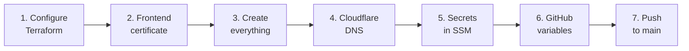
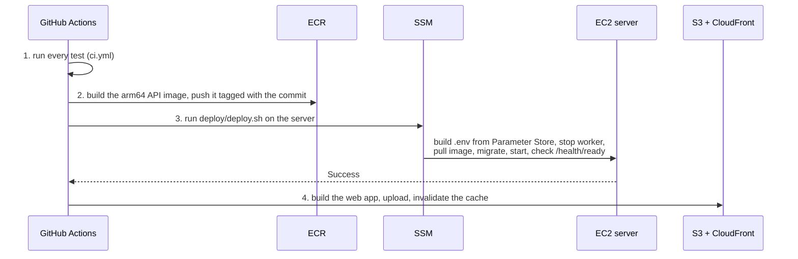

# Deploy production to AWS

You do steps 1 to 6 once. After that, every push to `main` tests and deploys on its own. Nothing is created in AWS until you run `terraform apply` yourself. All commands are for PowerShell on Windows.



## Before you start

```powershell
winget install Hashicorp.Terraform
winget install Amazon.AWSCLI
winget install Amazon.SessionManagerPlugin   # shell access to the server without SSH
winget install GitHub.cli
aws configure          # an IAM user or role that may create the resources (e.g. AdministratorAccess)
$env:AWS_REGION = "us-east-1"
```

You also need `xiong-mao.net` added to Cloudflare (the free plan is enough) and a Gemini API key.

## 1. Configure Terraform

```powershell
cd infra
Copy-Item terraform.tfvars.example terraform.tfvars   # edit if you change the region, repository, branch...
terraform init
```

Read Gemini's data terms, then set `provider_retention_verified = true` in `terraform.tfvars`. Until you do, the app offers no models.

## 2. Request the frontend certificate

```powershell
terraform apply -target="aws_acm_certificate.frontend"
terraform output acm_validation_record
```

In Cloudflare, under **DNS > Records**, add that **CNAME** with proxy status **DNS only**. Drop the trailing dots.

## 3. Create everything else

```powershell
terraform plan -out tfplan    # review what will be created
terraform apply tfplan        # waits until the certificate is issued (usually a few minutes)
```

## 4. Point the domains at AWS

```powershell
terraform output cloudflare_dns_records
```

Add both records in Cloudflare with proxy status **DNS only** (grey cloud):

| Type | Name | Content |
| --- | --- | --- |
| CNAME | `xiong-mao.net` (`@`) | `dxxxxxxxx.cloudfront.net` |
| A | `api` | the Elastic IP |

"DNS only" matters. Caddy needs direct traffic to obtain its certificate, and Cloudflare's proxy would cut long streamed answers after 100 seconds.

## 5. Store the secrets in SSM Parameter Store

Secrets never go in Git or Terraform. Generate them and store them directly:

```powershell
$path = terraform output -raw parameter_path
aws ssm put-parameter --name "$path/GEMINI_API_KEY" --type SecureString --value "YOUR_GEMINI_KEY"
$fernet = ..\backend\.venv\Scripts\python -c "from cryptography.fernet import Fernet; print(Fernet.generate_key().decode())"
aws ssm put-parameter --name "$path/KEY_ENCRYPTION_KEY" --type SecureString --value $fernet
$jwt = ..\backend\.venv\Scripts\python -c "import secrets; print(secrets.token_urlsafe(48))"
aws ssm put-parameter --name "$path/JWT_SECRET" --type SecureString --value $jwt
```

To change a secret later, run the same command with `--overwrite`, then redeploy. Every setting is listed in [configuration.md](configuration.md).

## 6. Give GitHub Actions its settings

These are repository variables. None of them is secret: they are names and IDs, and access is granted by the OIDC role, not by a key.

```powershell
gh auth login
$vars = terraform output -json github_variables | ConvertFrom-Json
$vars.PSObject.Properties | ForEach-Object { gh variable set $_.Name --body $_.Value }
```

## 7. Deploy

The `main` branch belongs to production: only pushes to it can deploy to AWS (`github_branch` in Terraform). Push it:

```powershell
git switch main
git push
gh run watch
```

## What a deploy does (`.github/workflows/deploy.yml`)



If any step fails, the later steps do not run, so a failed backend never gets a new frontend.

## Check it

```powershell
curl.exe https://api.xiong-mao.net/api/v1/health/ready    # {"status":"ok"}
start https://xiong-mao.net
```

Create an account on the sign-in page and start chatting. On the very first deploy Caddy may need a minute after DNS resolves to get its certificate.

Day-to-day tasks (shell, rollback, backups, restore) are in [operations.md](operations.md).
