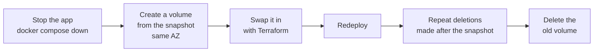

# Operating production (AWS)

Commands are for PowerShell on Windows, run from `infra\` unless noted, with the AWS CLI configured and `$env:AWS_REGION` set. For the staging VM, see [staging-gcp.md](staging-gcp.md#operating-it).

| I want to | Go to |
| --- | --- |
| See what is running, read logs | [Open a shell](#open-a-shell-on-the-server) |
| Ship a change or a new setting | [Deploy](#deploy) |
| Undo a bad release | [Roll back](#roll-back) |
| Recover lost or broken data | [Backups and restore](#backups-and-restore) |
| Get more memory, or a fresh server | [Replace or resize](#replace-or-resize-the-server) |
| Fix a document stuck in "processing" | [Stuck jobs](#stuck-jobs-and-unknown-usage) |
| Remove everything | [Tear down](#tear-down) |

## Open a shell on the server

There is no SSH. Session Manager opens a shell through IAM:

```powershell
aws ssm start-session --target (terraform output -raw server_instance_id)
```

Inside the session:

```bash
sudo -i
cd /opt/xiongmao
docker compose ps                 # what is running
docker compose logs -f api        # follow API logs (also: worker, caddy, db, migrate)
docker compose restart api
```

**Health check from anywhere:** `curl.exe https://api.xiong-mao.net/api/v1/health/ready` returns `{"status":"ok"}` when the API can reach the database.

## Deploy

| Situation | Do |
| --- | --- |
| Code change | Merge into `main` and push. The Deploy workflow tests, ships the backend, then the frontend. |
| Non-secret setting | Edit `terraform.tfvars`, `terraform apply`, then `gh workflow run deploy.yml`. |
| Secret | `aws ssm put-parameter --name "/xiongmao/prod/NAME" --type SecureString --value "..." --overwrite`, then `gh workflow run deploy.yml`. |
| Re-run without a change | `gh workflow run deploy.yml` |

The deploy rebuilds `.env` on the server each time, so settings take effect only after a deploy.

## Roll back

**Backend.** ECR keeps the last 5 images, tagged with their commit SHA. In a server shell:

```bash
sudo bash /opt/xiongmao/deploy.sh <ECR_REPOSITORY_URL>:<older-commit-sha>
```

Migrations only move forward. Keep them backward-compatible, so an older image still works with a newer schema.

**Frontend.** Revert the commit on `main` and push. The workflow rebuilds and republishes it.

## Backups and restore

- Data Lifecycle Manager snapshots the data disk daily and keeps 7 (`snapshot_retention_days`).
- For an extra logical backup, in a server shell:

  ```bash
  cd /opt/xiongmao
  docker compose exec -T db pg_dump -U chatbot chatbot | gzip > /data/backup.sql.gz
  ```

**Restore the data disk from a snapshot:**



1. In a server shell, run `docker compose down` in `/opt/xiongmao`.
2. In the EC2 console, create a volume from the snapshot in the same Availability Zone as the server.
3. Point Terraform at the new volume:

   ```powershell
   terraform state rm aws_ebs_volume.data aws_volume_attachment.data
   terraform import aws_ebs_volume.data <new-volume-id>
   terraform apply     # replaces the server, which then mounts the restored volume
   gh workflow run deploy.yml
   ```

4. Deletions made after the snapshot was taken come back with it. Repeat them.
5. Once everything works, delete the old volume yourself.

## Replace or resize the server

```powershell
terraform apply -replace="aws_instance.server"          # fresh Ubuntu, same data disk and IP
# or set instance_type = "t4g.small" in terraform.tfvars, then: terraform apply
gh workflow run deploy.yml                               # start the app on the new server
```

## Stuck jobs and unknown usage

A job left in `processing` after a worker crash is not picked up again on its own, because it may already have made a paid call.

1. Check the document's usage rows to see whether a paid call was made.
2. Mark the job `failed`, then use **Retry** on the document in the app.
3. Mark answers left `pending` or `streaming` after a crash as `interrupted`, and their usage as `unknown`. Never record unknown usage as zero.

```bash
docker compose exec db psql -U chatbot chatbot
```

## Tear down

`terraform destroy` refuses to run while the data disk is protected by `prevent_destroy`. Choose one:

- **Keep the data disk:** run `terraform state rm aws_ebs_volume.data aws_volume_attachment.data`, then `terraform destroy`.
- **Delete everything:** remove the `prevent_destroy` line from `infra/server.tf`, then `terraform destroy`.

Afterwards, delete the snapshots and the Cloudflare records yourself.
