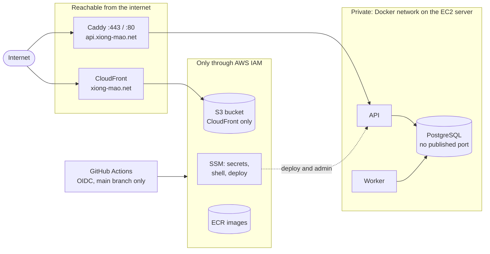
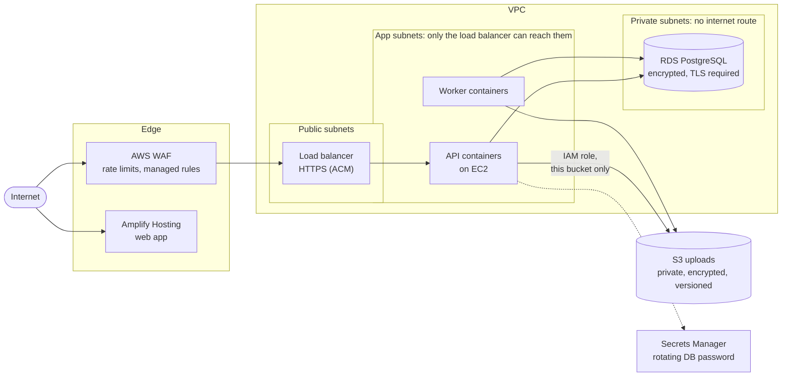
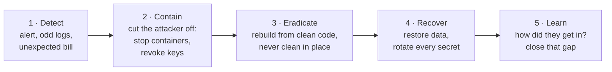
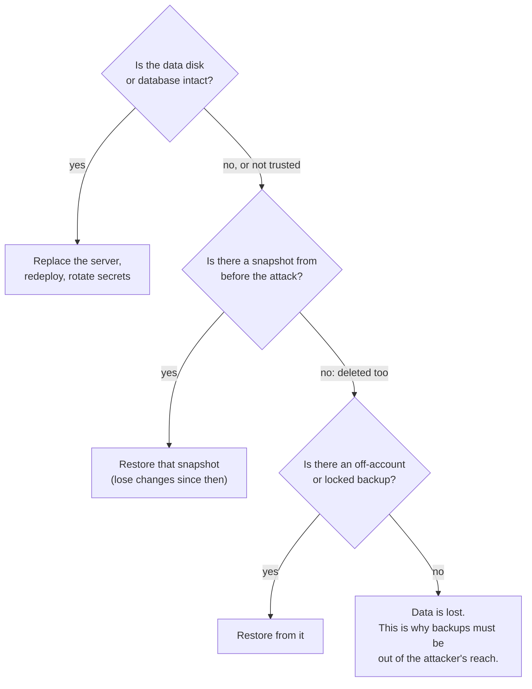

# Security

This page explains how the app is protected on AWS, what an attacker could try, and how to recover if something goes wrong. It covers two designs:

| | Structure 1: **current** (~$12 / month) | Structure 2: **bigger budget** (~$45 to $250+ / month) |
| --- | --- | --- |
| Backend | 1 EC2: Caddy, API, worker, PostgreSQL containers | EC2 (later: load balancer + several EC2) running API and worker containers |
| Database | PostgreSQL container on the same EC2 | RDS PostgreSQL (later Multi-AZ) |
| Frontend | S3 + CloudFront | Amplify Hosting |
| Uploads | EBS data disk | S3 |

Both designs are described in [cost.md](cost.md). The last part of this page lists protections that neither design includes because of the budget, and what each would cost.

## The idea: layers

No single control stops everything. Each layer assumes the one in front of it might fail.

```mermaid
flowchart LR
    attacker([Attacker]) --> L1
    subgraph L1["1 · Edge"]
        e1[HTTPS only, HSTS]
        e2[Only ports 80 / 443 open]
        e3[Request size limits]
    end
    subgraph L2["2 · Application"]
        a1[Sign-in: scrypt, JWT,<br/>lockout after 5 failures]
        a2[Every query filtered<br/>by the signed-in user]
        a3[Rate limits per user]
        a4[File type and size checks]
    end
    subgraph L3["3 · Server"]
        s1[No SSH, IAM-only access]
        s2[Containers as non-root]
        s3[Containers cannot<br/>reach AWS credentials]
    end
    subgraph L4["4 · Data"]
        d1[Database not reachable<br/>from the internet]
        d2[Disks encrypted]
        d3[Secrets only in<br/>SSM Parameter Store]
    end
    subgraph L5["5 · Recovery"]
        r1[Daily snapshots]
        r2[Rebuild the server<br/>from code in minutes]
    end
    L1 --> L2 --> L3 --> L4 --> L5
```

## Structure 1: the current setup

### Attack surface

Only two things are reachable from the internet: CloudFront for the web app and Caddy on the server. Everything else is private, or reachable only through AWS IAM.

### How each part is protected

| Part | Threat | Protection in place |
| --- | --- | --- |
| **Web app** (S3 + CloudFront) | Someone reads or replaces the files | The bucket is private and blocks public access. Only this CloudFront distribution can read it (Origin Access Control). Only the GitHub deploy role can write to it. |
| | Eavesdropping, downgrade | HTTPS only (HTTP redirects), TLS 1.2+, AWS managed security headers (HSTS, `nosniff`, frame and XSS protections) |
| **API** (Caddy + FastAPI) | Eavesdropping | HTTPS only, with an automatic Let's Encrypt certificate and HSTS |
| | Huge requests | Caddy rejects bodies over 12 MB; the API accepts files up to 10 MiB and 100 pages |
| | Password guessing | Passwords hashed with scrypt (memory-hard). 5 failures lock an email for 15 minutes, and 20 failures lock an IP address. |
| | Stolen tokens | Access token: 15 minutes, kept only in page memory. Refresh token: `httpOnly`, `Secure`, `SameSite=Strict` cookie, sent only to `/api/v1/auth`, and stored only as a hash. Changing the password ends every other session. |
| | Reading another user's data | Every query is filtered by the signed-in user's ID. Projects, chats and documents never cross users or projects. |
| | Calls from other websites | CORS allows only `https://xiong-mao.net` |
| | SQL injection | All queries go through SQLAlchemy with bound parameters, with no hand-built SQL strings |
| | Script injection (XSS) through answers | Answers are rendered as Markdown without raw HTML, and links open with `noopener noreferrer` |
| | Malicious uploads | Only PDF (checked by its `%PDF-` header), UTF-8 text and Markdown. Files are parsed as text and never executed. Encrypted and scanned PDFs are refused. |
| | Running up the AI bill | Per user: 10 answers a minute, 100 a day, 2 at a time, 100 files, 100 MiB |
| | Learning about the API | Interactive API docs are off in production. Errors return a code and a request ID, never a stack trace. |
| **Database** (PostgreSQL container) | Direct connection from the internet | No published port: only containers on the same Docker network can reach it. The security group allows only 80 and 443 anyway. |
| | Weak password | Random 48-character password generated on the server; it never leaves `/data/postgres-password` |
| | Stolen disk or snapshot | EBS volumes and their snapshots are encrypted |
| **Server** (EC2) | SSH brute force | No SSH and no port 22. Shells and deploys go through SSM, which IAM authorizes and AWS logs. |
| | Stolen instance credentials | IMDSv2 tokens required, hop limit 1: containers cannot reach the instance role, so a compromised API cannot read Parameter Store |
| | Container escape | The API and worker run as a non-root user (uid 10001) |
| | Unpatched OS | Ubuntu's unattended security upgrades are on by default; replacing the server gives a fresh image |
| **Secrets** | Leaked in Git or Terraform state | Secrets exist only as SecureString parameters in SSM, plus a root-only `.env` on the server. Users' own API keys are encrypted with Fernet in the database. |
| **CI/CD** (GitHub Actions) | Stolen AWS keys | There are none. GitHub gets 1-hour credentials through OIDC, and only for pushes to `main` of this repository. |
| | Misusing the deploy role | It can push to one ECR repository, write two buckets, invalidate one distribution, and run commands only on the server tagged `xiongmao-api` |
| | Vulnerable image | ECR scans every pushed image |

### Weak spots to know about

| Weak spot | Why it matters | Cheapest fix |
| --- | --- | --- |
| Snapshots live in the same AWS account | An attacker with admin access to the account could delete the server and its snapshots together | Copy backups to a second account, or lock them ([below](#protections-not-in-either-design)) |
| No alerting | An attack or outage is noticed only when someone looks | Billing alarm, GuardDuty, uptime check |
| One server | A flood of requests or a crash takes the API down | Accepted at this budget; Structure 2 fixes it |
| No Content-Security-Policy | A future XSS bug would have more room to act | Add a CSP to the CloudFront response headers policy |
| Anyone who can push to `main` can deploy | A stolen GitHub account could ship malicious code | Branch protection with required reviews, 2FA on GitHub |
| Image tags not pinned (`caddy:2`, `pgvector:pg16`) | A compromised upstream image would be pulled on the next deploy | Pin images by digest; update them on purpose |

## Structure 2: the bigger-budget setup

Same app, same application-level protections. The infrastructure adds network separation and managed services.

| Part | What changes compared to Structure 1 |
| --- | --- |
| **Web app** (Amplify) | Amplify serves over HTTPS with its own CDN. Add a CSP and the other security headers in Amplify's custom headers. Pull-request previews should require a password, or stay off. |
| **API** | Traffic enters through the load balancer, and WAF can sit in front of it. The EC2 security group accepts traffic only from the load balancer's security group, so the servers are not reachable directly. Several containers on several servers mean one compromised or crashed container does not take the service down. |
| **Database** (RDS) | Runs in private subnets with no internet route. Its security group accepts port 5432 only from the app's security group. Storage, snapshots and logs are encrypted with KMS. Set `rds.force_ssl = 1` so every connection uses TLS. Turn on deletion protection. Secrets Manager stores and rotates the password. |
| **Uploads** (S3) | Block Public Access on, SSE-KMS encryption, versioning (an overwrite or delete keeps the old copy), and a bucket policy that allows only the app's IAM role and requires TLS. The servers hold no data, so a compromised server is simply replaced. |
| **Backups** | RDS automated backups with point-in-time restore (up to 35 days), plus S3 versioning |
| **Availability** | Multi-AZ RDS and servers in two Availability Zones keep running through the loss of a server or a whole zone |

## If you are attacked: what to do

Follow the same five steps for any incident. Act quickly on the first two, and keep notes with times as you go.

### Scenario playbook

| What happened | Contain | Recover |
| --- | --- | --- |
| **API server compromised** (unknown process, changed files, odd outbound traffic) | Snapshot the data disk for evidence, then `docker compose down` in a Session Manager shell. Do not try to clean the server. | `terraform apply -replace="aws_instance.server"` gives a fresh server with the same data disk and IP. Then redeploy a known-good commit and [rotate every secret](#rotating-secrets). If the database may be altered, restore the last snapshot from before the attack ([operations.md](operations.md#backups-and-restore)). |
| **Database wiped or encrypted** (ransomware) | Stop the stack so nothing more is written | Restore the data disk from the latest clean snapshot ([operations.md](operations.md#backups-and-restore)). In Structure 2: RDS point-in-time restore to the minute before the attack. |
| **Gemini API key leaked** | Delete the key in Google AI Studio at once | Create a new key, `aws ssm put-parameter --overwrite`, `gh workflow run deploy.yml` |
| **User accounts taken over** (credential stuffing) | The lockout slows it down. To sign everyone out, delete all rows in `login_sessions` and rotate `JWT_SECRET`. | Users change their passwords; changing one ends all other sessions |
| **Malicious code pushed to `main`** | Revoke the attacker's GitHub access, then revert the commit | Redeploy the last good commit ([roll back](operations.md#roll-back)), then review what the bad version could have done with the data |
| **AWS account access stolen** (unknown users, instances, crypto miners, a big bill) | Sign in as root (with MFA), disable unknown IAM users and keys, and delete unknown resources | Check CloudTrail Event history for every change, rotate every secret, and contact AWS Support (they often waive fraudulent charges) |
| **Flood of traffic** (DDoS) | The web app is on CloudFront, which absorbs floods; AWS Shield Standard is automatic and free. For the API, block the source addresses in the security group. | Structure 2: a WAF rate-based rule blocks abusive addresses automatically |

### Rotating secrets

After any compromise of the server or the account, assume every secret is known. Replace them all in Parameter Store, then redeploy once.

| Secret | How | Side effect |
| --- | --- | --- |
| `GEMINI_API_KEY` | New key in Google AI Studio, delete the old one | None |
| `JWT_SECRET` | `python -c "import secrets; print(secrets.token_urlsafe(48))"` | Access tokens stop working. Browsers renew them with their refresh cookie, unless you also cleared `login_sessions`. |
| Database password | `ALTER USER chatbot PASSWORD '...'` in `psql`, then write the same value to `/data/postgres-password` | None after the redeploy |
| `KEY_ENCRYPTION_KEY` | Generate a new Fernet key | Saved personal API keys can no longer be decrypted. Ask users to enter them again. |
| GitHub, AWS and Cloudflare sign-ins | Change passwords, check that MFA is on, remove unknown sessions and tokens | None |

### Can we restore?

Today the last question has no "yes": both the server and its snapshots are in one account. The cheapest protection against that is in the next section.

## Protections not in either design

These were left out to keep the budget. They are listed roughly from best value to most expensive. Costs are approximate for an app of this size.

```mermaid
flowchart LR
    subgraph free["Free or nearly free: do these first"]
        f1[Root MFA, no root keys]
        f2[Billing alarm]
        f3[GitHub branch protection + 2FA]
        f4[Dependabot alerts]
        f5[CSP header]
        f6[Pin image digests]
    end
    subgraph low["About $1 to $10 a month"]
        l1[GuardDuty]
        l2[CloudTrail trail to S3]
        l3[Locked or off-account backups]
        l4[Uptime check + alarms]
        l5[CloudWatch logs]
    end
    subgraph more["About $10 to $50+ a month"]
        m1[AWS WAF]
        m2[Inspector]
        m3[AWS Config + Security Hub]
        m4[Secrets Manager rotation]
    end
    free --> low --> more
```

| Protection | What it does | Approx. cost / month | How |
| --- | --- | --- | --- |
| **Root MFA, no root access keys** | Stops the worst case: full account takeover | Free | IAM console > Security credentials |
| **Billing alarm** | A hijacked account usually shows up first as an unexpected bill | Free | AWS Budgets: alert at $20 |
| **GitHub branch protection + 2FA** | A stolen GitHub account cannot deploy straight to production | Free | Settings > Rules: require a pull request and passing CI on `main` |
| **Dependabot** | Alerts and pull requests for vulnerable Python and npm packages | Free | Add `.github/dependabot.yml` |
| **Content-Security-Policy** | Limits what injected script could do or where it could send data | Free | A custom CloudFront response headers policy, or Amplify custom headers |
| **Pinned image digests** | A tampered upstream image is never pulled by surprise | Free | `caddy:2@sha256:...` in `compose.yaml`, updated on purpose |
| **GuardDuty** | Detects credential misuse, crypto mining and contact with known bad addresses, from AWS logs | ~$1–5 | Turn it on per region (30-day free trial) |
| **CloudTrail trail to S3** | Keeps the record of every AWS API call longer than the free 90 days, out of an attacker's reach | ~$1 (the first management-events trail is free; you pay for S3) | Trail to a bucket with Object Lock |
| **Backups out of the attacker's reach** | Restore is possible even if the account is taken over | ~$1–3 | AWS Backup with a Vault Lock, or copy snapshots to a separate backup account |
| **Uptime check + alarms** | Know within minutes when the API is down | Free–$1 | Route 53 health check or CloudWatch Synthetics on `/api/v1/health/ready`, with SNS email |
| **Central logs** | Logs survive the server and can be searched after an incident | ~$0.50 per GB | CloudWatch agent, or Docker's `awslogs` log driver |
| **AWS WAF** | Blocks common attacks and limits request rates before they reach the app | ~$10 + $0.60 per million requests | Attach to CloudFront or the load balancer; add a rate-based rule and AWS managed rule groups |
| **Amazon Inspector** | Continuously scans the EC2 server and images for known vulnerabilities | ~$1–2 per instance + per image | Turn it on in the console |
| **AWS Config + Security Hub** | Flags misconfigurations, for example a bucket made public | ~$5–20 | Turn on with the AWS Foundational Security Best Practices standard |
| **Secrets Manager rotation** | Rotates the database password automatically | $0.40 per secret | Structure 2, for the RDS password |
| **Shield Advanced** | DDoS response team and cost protection | $3,000 (1-year commitment) | Only for a business that needs it |

**A good next step** that fits the current budget for about $5 a month: root MFA, a billing alarm, branch protection, Dependabot, GuardDuty and a locked backup copy. Those six close most of the [weak spots](#weak-spots-to-know-about) above.

## Risks specific to an AI app

| Risk | What it means | Current position |
| --- | --- | --- |
| **Prompt injection** | An uploaded document contains instructions such as "ignore your rules" | A document is only ever used in its owner's own chats, so the worst result is a misleading answer to the person who uploaded it. Answers cite their sources so they can be checked. |
| **Data sent to the AI provider** | Questions and passages go to Gemini | Models are offered only after `PROVIDER_RETENTION_VERIFIED` confirms the provider's data terms were reviewed. Deleting content cannot recall copies already sent. |
| **Cost abuse** | A script spends the shared Gemini key | Per-user limits (10 a minute, 100 a day), plus a budget alert on the Google side |
| **Users' own API keys** | A database leak would expose them | Encrypted with `KEY_ENCRYPTION_KEY`, which is stored outside the database |
