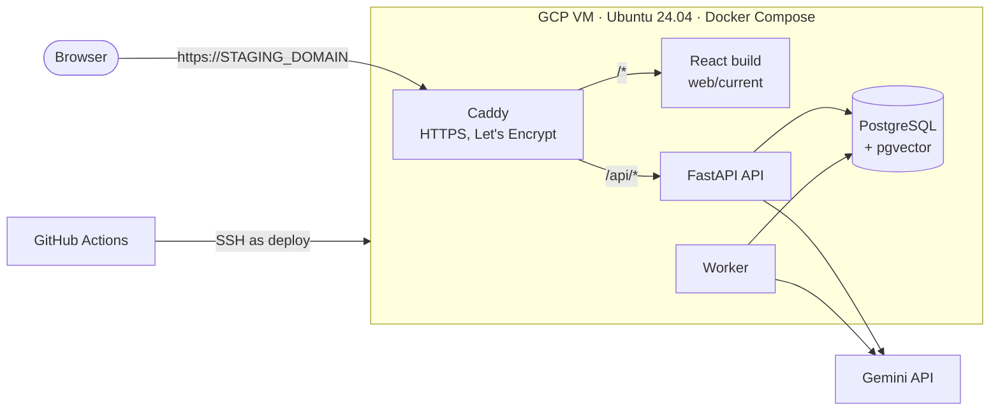
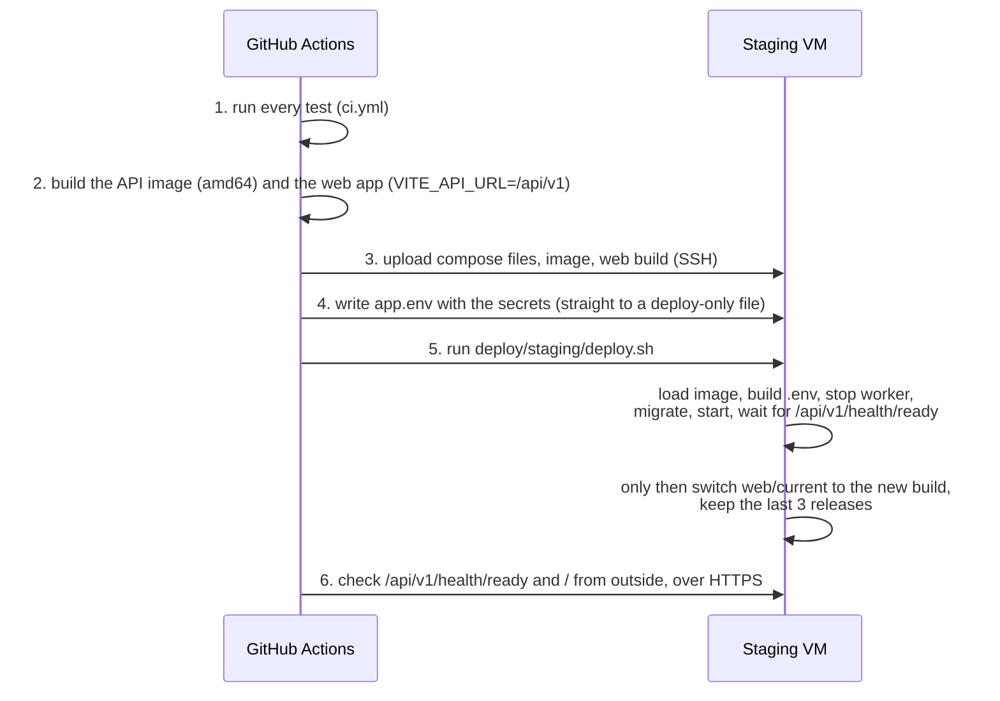

# Staging on one GCP VM

Staging runs the whole app on one Compute Engine VM. The `staging` branch belongs to this VM: every push to it runs all the tests, then GitHub Actions deploys over SSH. Production is separate and runs on AWS from the `main` branch ([deploy-aws.md](deploy-aws.md)).



The web app and the API share one domain, so there is no CORS and the sign-in cookie stays first-party. Staging runs with `APP_ENV=production`, so it behaves exactly like production: secrets are required, cookies are `Secure` and the API docs are off.

## How it differs from production

| | Staging (GCP VM) | Production (AWS) |
| --- | --- | --- |
| Web app | Caddy on the VM, `deploy/staging/Caddyfile` | S3 + CloudFront |
| API address | `https://<domain>/api/v1` | `https://api.xiong-mao.net/api/v1` |
| Image | built in CI (amd64), copied over SSH as a file | built in CI (arm64), pushed to ECR |
| Settings and secrets | GitHub environment `staging` | SSM Parameter Store |
| Deploy channel | SSH, as the `deploy` user | SSM Run Command (no SSH) |
| Backups | optional disk snapshot schedule | daily data-disk snapshots |

Everything else is shared: the same `Dockerfile`, `deploy/compose.yaml`, migrations and tests. `deploy/staging/compose.yaml` only adds the web files and the staging Caddyfile on top.

## Where things live on the VM

| Part | Path |
| --- | --- |
| Compose files | `/opt/xiongmao/compose.yaml` + `/opt/xiongmao/staging/compose.yaml` |
| Web releases | `/opt/xiongmao/web/releases/<commit>`, live one linked from `web/current` |
| Settings | `/opt/xiongmao/app.env` (from GitHub) and `.env` (built by `deploy.sh`), readable only by `deploy` |
| Database, uploads, certificates | `/data/postgres`, `/data/storage`, `/data/caddy` |
| Database password | `/data/postgres-password`, generated on the first deploy |

## How a deploy works (`.github/workflows/staging.yml`)



If the API does not become ready, the web app is not switched and the run fails, so the old web app keeps working.

## One-time setup

These commands create billable GCP resources. Nothing below is created automatically.

**1. Tools and project**

```bash
# Install the Google Cloud CLI (cloud.google.com/sdk/docs/install) and the GitHub CLI (cli.github.com) first.
gcloud auth login
gcloud config set project YOUR_PROJECT_ID
gcloud config set compute/region us-central1
gcloud config set compute/zone us-central1-a
gcloud services enable compute.googleapis.com
```

**2. A fixed IP, the VM and the firewall**

```bash
gcloud compute addresses create xiongmao-staging
gcloud compute instances create xiongmao-staging \
  --machine-type e2-small \
  --image-family ubuntu-2404-lts-amd64 --image-project ubuntu-os-cloud \
  --boot-disk-size 20GB --boot-disk-type pd-balanced \
  --address xiongmao-staging --tags xiongmao-web
gcloud compute firewall-rules create xiongmao-web --allow tcp:80,tcp:443 --target-tags xiongmao-web
ip=$(gcloud compute addresses describe xiongmao-staging --format "value(address)")
echo "$ip"
```

`e2-small` (2 GB) is comfortable. `e2-micro` (1 GB, free tier in some US regions) also works thanks to the swap the setup script adds, but indexing is slower. Port 22 is open through the default network's `default-allow-ssh` rule. GitHub's runners have no fixed addresses, so it must stay open, but only key logins work.

**3. A domain.** Pick one:

| Option | Domain to use | Setup |
| --- | --- | --- |
| No DNS needed | the IP with dashes + `.sslip.io`, e.g. `34-171-6-73.sslip.io` | none: it resolves to that IP automatically |
| Your own domain | e.g. `staging.xiong-mao.net` | In Cloudflare, an **A** record `staging` → `$ip`, proxy status **DNS only** (grey cloud) |

Caddy needs direct traffic to get its certificate, and Cloudflare's proxy would cut long answers, so never turn the proxy on.

**4. A key for GitHub Actions and the VM setup**

```bash
ssh-keygen -t ed25519 -f staging_deploy -N '' -C github-staging
gcloud compute scp deploy/staging/setup-vm.sh staging_deploy.pub xiongmao-staging:~
gcloud compute ssh xiongmao-staging --command "sudo bash setup-vm.sh staging_deploy.pub"
ssh-keyscan -t ed25519 "$ip" > staging_known_hosts
```

`setup-vm.sh` installs Docker, adds 2 GiB swap, creates the `deploy` user (Docker access, no sudo, key login only) and creates `/opt/xiongmao` and `/data`. `staging_known_hosts` holds the VM's host key: the deploy refuses to talk to any other server.

**5. The GitHub environment `staging`.** Generate the secrets:

```bash
jwt=$(backend/.venv/bin/python -c "import secrets; print(secrets.token_urlsafe(48))")
fernet=$(backend/.venv/bin/python -c "from cryptography.fernet import Fernet; print(Fernet.generate_key().decode())")
```

Then store them along with the rest (replace the domain with yours from step 3):

```bash
gh api -X PUT "repos/{owner}/{repo}/environments/staging" > /dev/null
gh variable set STAGING_HOST --env staging --body "$ip"
gh variable set STAGING_DOMAIN --env staging --body "34-171-6-73.sslip.io"
gh variable set STAGING_SSH_KNOWN_HOSTS --env staging --body "$(cat staging_known_hosts)"
gh variable set PROVIDER_RETENTION_VERIFIED --env staging --body "true"   # after reviewing Gemini's data terms
gh secret set STAGING_SSH_KEY --env staging < staging_deploy
gh secret set JWT_SECRET --env staging --body "$jwt"
gh secret set KEY_ENCRYPTION_KEY --env staging --body "$fernet"
gh secret set GEMINI_API_KEY --env staging --body "YOUR_GEMINI_KEY"
rm staging_deploy   # the private key now lives only in GitHub
```

| Name | Kind | Required | Purpose |
| --- | --- | --- | --- |
| `STAGING_HOST` | variable | yes | VM address for SSH |
| `STAGING_DOMAIN` | variable | yes | Public domain for the app and the API, without `https://` |
| `STAGING_SSH_KNOWN_HOSTS` | variable | yes | The VM's host key (output of `ssh-keyscan`) |
| `STAGING_SSH_USER` | variable | no | Default `deploy` |
| `PROVIDER_RETENTION_VERIFIED` | variable | no | `true` offers models; until then the picker is empty |
| `MODEL_CATALOG_JSON`, `PROVIDER_POLICY_URL` | variable | no | See [configuration.md](configuration.md) |
| `STAGING_SSH_KEY` | secret | yes | Private key for `deploy@VM` |
| `JWT_SECRET` | secret | yes | 32+ characters; signs access tokens |
| `GEMINI_API_KEY` | secret | yes | Chat and embeddings |
| `KEY_ENCRYPTION_KEY` | secret | no | Lets users save their own API keys |
| `OPENAI_API_KEY` | secret | no | Also offer OpenAI models |

The workflow checks the required ones first and names any that are missing.

**6. Deploy.** Every push to the `staging` branch deploys:

```bash
git switch staging
git push
gh run watch
xdg-open https://34-171-6-73.sslip.io   # macOS: open
```

To redeploy without a code change (for example after changing a secret): `gh workflow run staging.yml --ref staging`.

## Operating it

```bash
gcloud compute ssh xiongmao-staging
```

Then, on the VM:

```bash
sudo -iu deploy
cd /opt/xiongmao
docker compose ps
docker compose logs -f api            # also: worker, caddy, db, migrate
ls web/releases                       # releases you can roll back to
bash staging/deploy.sh <release>      # roll back (API image and web app together)
docker compose exec -T db pg_dump -U chatbot chatbot | gzip > /data/backup.sql.gz
```

For backups, add a snapshot schedule to the boot disk:

```bash
gcloud compute resource-policies create snapshot-schedule xiongmao-daily --max-retention-days 7 --daily-schedule --start-time 04:00
gcloud compute disks add-resource-policies xiongmao-staging --resource-policies xiongmao-daily
```

**Tear down:** `gcloud compute instances delete xiongmao-staging`, `gcloud compute addresses delete xiongmao-staging`, `gcloud compute firewall-rules delete xiongmao-web`, then remove the DNS record if you made one.
