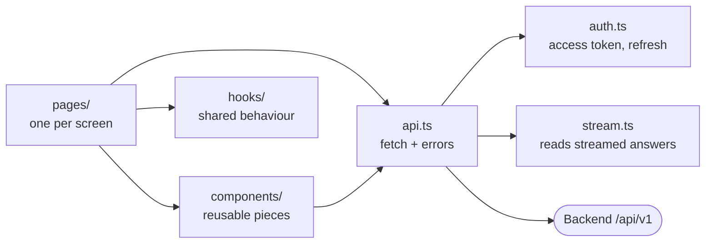

# Frontend

The web app: React 19 + TypeScript, built with Vite into static files. Production serves them from S3 + CloudFront; staging serves them from Caddy on the VM.



## Layout

```
frontend/
├── src/
│   ├── main.tsx            Entry point (also stops a stray file drop from leaving the app)
│   ├── App.tsx             Sign-in gate, sidebar and page switching (URL path = page)
│   ├── pages/              ChatPage, ProjectsPage, UsagePage, SettingsPage, AccountPage
│   ├── components/         Sidebar, composer, messages, citations, documents, dialogs, sign-in, usage charts
│   ├── hooks/              useChatDocuments, useFileDrop (drag and drop), useDismiss (close on Escape or outside click)
│   ├── api.ts              request()/api(): adds the access token, retries once after a 401, raises ApiError
│   ├── auth.ts             Sign in, sign up, sign out, password change; the access token lives in memory only
│   ├── stream.ts           Parses the Server-Sent Events stream of an answer (unit-tested)
│   ├── documents.ts        Upload checks (type, 10 MiB) and upload calls
│   ├── usage.ts            Usage page filters and date helpers
│   ├── prefs.ts            Appearance and response preferences, with defaults
│   ├── format.ts, types.ts Display helpers and shared types
│   └── styles.css          All styles, with themes as CSS variables
├── e2e/                    Playwright test against a mocked API
├── index.html, vite.config.ts, playwright.config.ts, tsconfig.json
└── package.json
```

## Where the API is

The only build setting is `VITE_API_URL`:

| Environment | Value |
| --- | --- |
| Local | unset: the app calls port 8000 on the page's own host |
| Staging | `/api/v1` (same domain as the page) |
| Production | `https://api.xiong-mao.net/api/v1` |

It is compiled into public JavaScript, so it must never hold a key.

## Commands

Run from `frontend/`:

| Command | Does |
| --- | --- |
| `npm ci` | Install the exact versions in `package-lock.json` |
| `npm run dev` | Dev server on http://localhost:5173 (the start-local script runs it for you) |
| `npm test` | Unit tests (Vitest) |
| `npm run typecheck` | TypeScript check only |
| `npm run build` | Type-check and build into `dist/` |
| `npx playwright install chromium && npm run test:e2e` | End-to-end test in a real browser, with every API call mocked (port 5180) |

CI runs `npm test`, `npm run build` and `npm run test:e2e` on every push.
